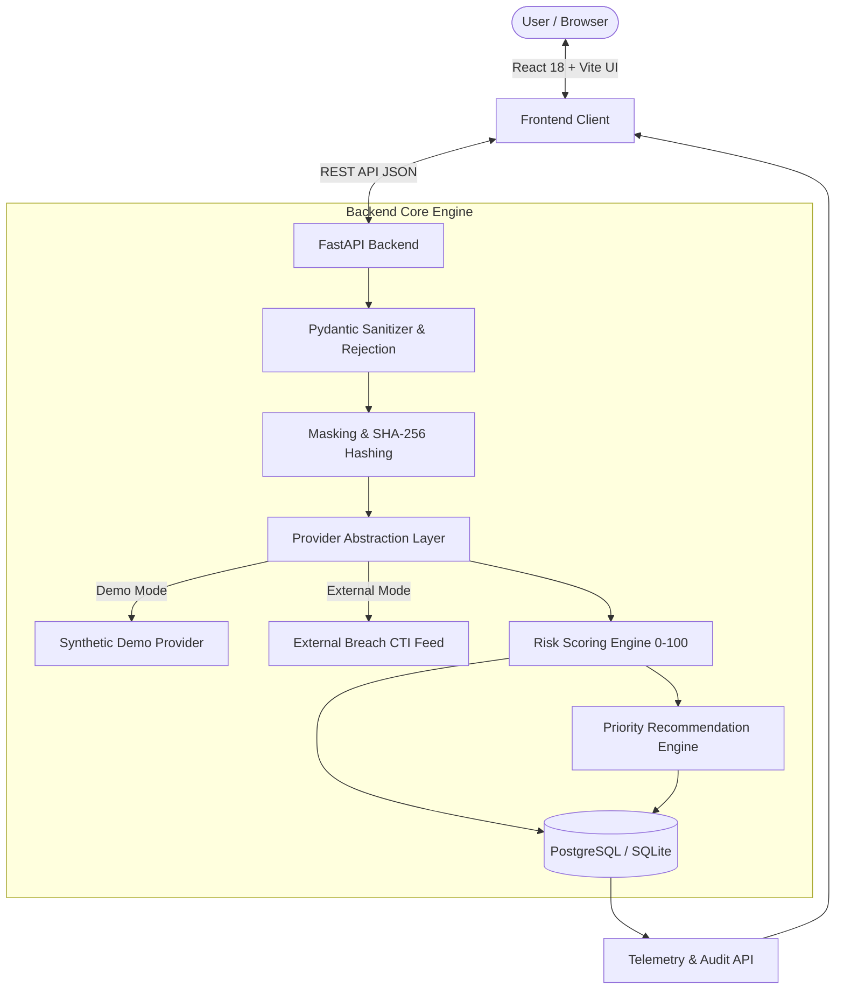

# 🛡️ LEAKLENS
### *Personal Data Exposure & Cyber Risk Assessment Tool*
**Academic Minor Project — Bachelor of Computer Applications (BCA) 5th Semester**

[](https://www.python.org/)
[](https://fastapi.tiangolo.com/)
[](https://react.dev/)
[](https://tailwindcss.com/)
[](https://opensource.org/licenses/MIT)

---

## 📌 Project Overview & Problem Statement
Every year, billions of personal user credentials and metadata records are leaked through third-party web application breaches. Traditional tools merely present a cryptic binary alert ("Pwned" / "Not Pwned") without context, causing panic and leaving users uncertain of what actions to take.

**LeakLens** solves this by:
1. Identifying whether an identifier (email address or username) appears in recorded breach events.
2. Breaking down the specific data categories exposed (Email, Username, IP, Account Metadata, Password indicators).
3. Computing a transparent, rule-based **Cyber Risk Index (0–100)** with individual point justifications.
4. Delivering prioritized, actionable security counter-measures (CRITICAL, HIGH, MEDIUM, GENERAL).
5. Enforcing a strict **Privacy-First Policy** — **LeakLens never collects, stores, or handles actual passwords or secrets.**

---

## 🏗️ System Architecture



---

## 🚀 Key Features

- 🔍 **Multi-Format Scanner**: Tabbed validation for Email addresses and Usernames.
- ⚡ **Real-Time Dynamic Feedback**: Multi-step animated progress indicators explaining each analysis stage.
- 📊 **Transparent Risk Scoring Engine**: Calculates an educational 0–100 score with explicit factor breakdowns (+10, +15, +30).
- 🛡️ **Priority Defensive Recommendations**: Tailored remediation steps based on the exact threat vectors identified.
- 📈 **Interactive Security Telemetry Dashboard**: Real-time KPI cards, category breakdown bar charts, and risk tier distribution pie charts via Recharts.
- 📋 **Local Hardening Checklist**: Interactive checklist with progress percentage and local storage persistence.
- 🔒 **Privacy-Preserving Audit Logs**: SHA-256 hashed and masked records with one-click history deletion.
- 🎭 **Built-In Offline Demo Mode**: Three pre-configured demonstration scenarios safe for viva presentations without internet dependencies.

---

## 🛠️ Technology Stack

| Layer | Technology |
|---|---|
| **Frontend** | React 18, Vite, Tailwind CSS, Lucide React, Recharts, React Router |
| **Backend** | Python 3.12, FastAPI, Pydantic v2, Uvicorn |
| **Database** | PostgreSQL / SQLite with SQLAlchemy 2.0 ORM, Alembic |
| **Security** | SHA-256 Cryptographic Hashing, Input Sanitizers, CORS Whitelisting |
| **Testing** | Pytest, Pytest-Asyncio, HTTPX |
| **DevOps** | Docker, Docker-Compose |

---

## ⚡ Quick Start Guide (Local Development)

### 1. Clone & Prerequisites
Ensure Python 3.10+ and Node.js 18+ are installed.

```bash
git clone https://github.com/your-username/leaklens.git
cd "minor project"
```

### 2. Backend Setup
```bash
# Create virtual environment
python -m venv venv

# Activate virtual environment (Windows PowerShell)
.\venv\Scripts\Activate.ps1
# (Linux/macOS: source venv/bin/activate)

# Install Python dependencies
pip install -r backend/requirements.txt

# Start FastAPI server
python -m uvicorn app.main:app --app-dir backend --reload --port 8000
```
- **Backend API**: `http://127.0.0.1:8000`
- **Swagger Documentation**: `http://127.0.0.1:8000/docs`

### 3. Frontend Setup (In a separate terminal)
```bash
cd frontend

# Install dependencies
npm install

# Start Vite development server
npm run dev
```
- **Frontend App**: `http://localhost:5173`

---

## 🐳 Docker Setup (One-Command Deployment)

Run the entire full-stack application (PostgreSQL + FastAPI + React + Nginx):

```bash
docker-compose up --build
```
- Frontend: `http://localhost:3000`
- Backend API: `http://localhost:8000`
- Swagger Docs: `http://localhost:8000/docs`

---

## 🧪 Running Automated Tests

```bash
# Set PYTHONPATH and run Pytest
$env:PYTHONPATH="backend"
pytest backend/tests -v
```

All 17 unit and integration test cases validate input sanitization, mathematical risk calculation, recommendation logic, capping, and API routes.

---

## 🎭 Presentation Demo Scenarios

In the scanner console, click on the quick demo scenarios or enter:

| Scenario | Input Email | Incidents | Expected Risk | Notes |
|---|---|---|---|---|
| **Safe Demo** | `safe.demo@example.com` | 0 | **0 / 100 (LOW)** | Clean baseline posture, 0 pts |
| **Exposed Demo** | `exposed.demo@example.com` | 2 | **65 / 100 (HIGH)** | Forum & shopping leaks (+15 multi, +10 email, +10 user, +10 IP, +5 meta, +15 recency) |
| **High Risk Demo** | `highrisk.demo@example.com` | 3 | **100 / 100 (CRITICAL)** | Raw 110 pts capped at 100 (+20 multi, +30 pass indicator, +15 PII, +10 email, +10 user, +10 IP, +15 recency) |

---

## 📚 Academic Documentation & Presentation Support

Detailed project artifacts are available in the [`docs/`](./docs) folder:
- 📑 [System Architecture & Data Flows](./docs/architecture.md)
- 🔌 [REST API Endpoints Specification](./docs/api.md)
- 🗄️ [Database ER Diagram & Schema Design](./docs/database.md)
- 🧮 [Risk Engine Mathematical Methodology](./docs/risk-scoring.md)
- 🔒 [Security & Defensive Framework](./docs/security.md)
- 🧪 [Automated Test Suite Guide](./docs/testing.md)
- 📽️ [12-Slide College Presentation Outline](./docs/presentation-outline.md)
- ❓ [30+ BCA Viva Questions & Answers](./docs/viva-questions.md)

---

## ⚖️ Ethical & Educational Disclaimer
LeakLens is an educational minor project developed for academic evaluation. The absence of a detected breach does not guarantee immunity from cyber compromise. Users must practice continuous cyber hygiene, adopt unique passwords, and enable multi-factor authentication across all sensitive services.

---

## 📋 FINAL QA AUDIT REPORT

| Module | Audit Criteria | QA Status | Observations & Verification |
|---|---|---|---|
| **1. Scanner** | Email/Username tabs, validation, password rejection, demo scenario loaders | ✅ **PASSED** | Live client & server regex validation; rejection of secrets with HTTP 422. |
| **2. Risk Engine** | Mathematical formula, determinism, tier classifications, capping at 100 | ✅ **PASSED** | Safe (0/100), Exposed (65/100), High Risk (100/100, Raw 110 capped). 100% backend-calculated. |
| **3. Results** | Incident counts, risk gauge, factor breakdown table, dynamic recommendations | ✅ **PASSED** | Renders dynamic factor weights and priority recommendations without hardcoding. |
| **4. Dashboard** | Real-time KPI cards, category breakdown, risk distribution, recent activity | ✅ **PASSED** | Dynamically aggregated from SQLite / PostgreSQL database scans via ORM. |
| **5. History** | Privacy-preserving audit logs, search/filter, single-click history purge | ✅ **PASSED** | Retains HMAC-SHA256 digests and masked identifiers; purge operates with cascade deletion. |
| **6. Security Tips** | 8 categorized cyber domains, search filter, educational best practices | ✅ **PASSED** | All 8 defensive categories load with actionable guidance and importance ratings. |
| **7. Reports** | JSON export, Print dialog, data consistency | ✅ **PASSED** | Browser JSON download matches active scan UUID; CSS print layout supported. |
| **8. Privacy & Security** | Zero password storage, HMAC-SHA256 server secret, no stack traces | ✅ **PASSED** | Server-side secret key hashing; no sensitive data or stack traces exposed to client. |
| **9. Error Handling** | Empty inputs, invalid formats, non-existent UUIDs, graceful degradations | ✅ **PASSED** | Returns structured JSON error details with user-friendly explanations. |
| **10. Automated Tests** | Pytest unit, integration, and mathematical consistency suite | ✅ **PASSED** | **17 / 17 tests passed (100%)** with 0 codebase warnings. |

