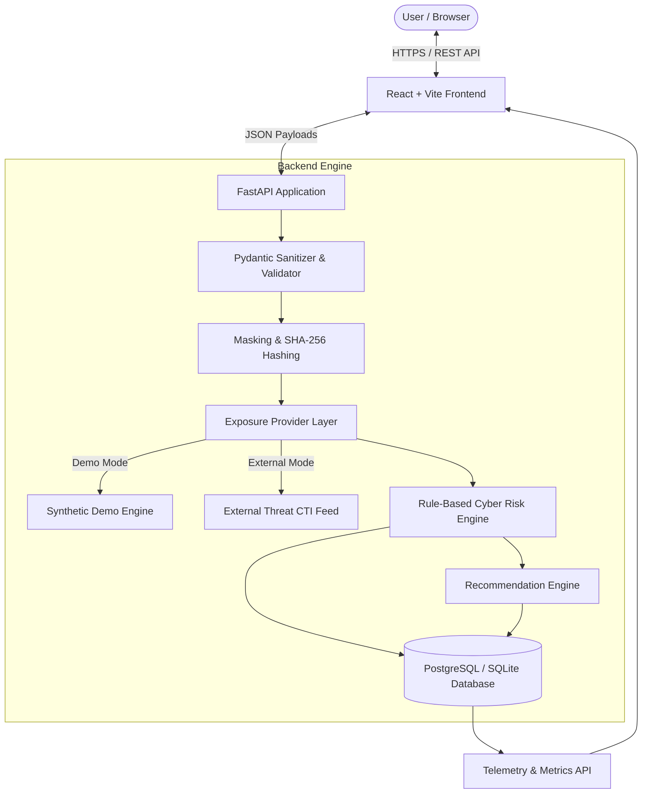

# LeakLens System Architecture

## 1. System Overview
**LeakLens** is an educational, defensive cybersecurity tool that assesses personal data exposure footprints and computes transparent, rule-based cyber risk scores without ever handling or collecting user credentials.

## 2. Core Modules
- **Client Tier (React + Vite + Tailwind CSS)**: Renders a cybersecurity console with live validation, SVG risk gauges, Recharts data visualization, and an interactive checklist.
- **API Tier (FastAPI)**: Validates input strings, rejects credential leaks, and exposes endpoints for scanning, reports, telemetry, and tips.
- **Provider Abstraction Layer (`ExposureProvider`)**: Decouples threat data retrieval. Default `DemoExposureProvider` generates safe synthetic breach metadata for reliable offline college presentations; `ExternalExposureProvider` connects to external threat feeds if configured.
- **Cyber Risk Engine (`risk_engine.py`)**: Computes a deterministic 0–100 risk score based on incident count, exposed category weights, and recency.
- **Recommendation Engine (`recommendation_engine.py`)**: Yields prioritized, actionable mitigation steps (CRITICAL, HIGH, MEDIUM, GENERAL).
- **Persistence Tier (SQLAlchemy ORM + SQLite/PostgreSQL)**: Stores masked identifiers and SHA-256 digests.
