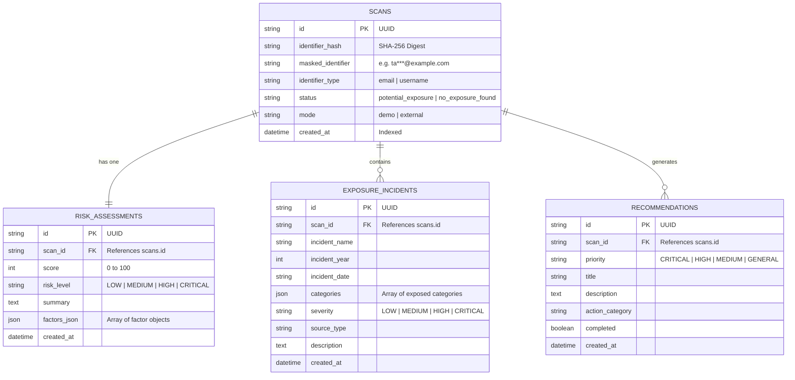

# LeakLens Database Architecture

LeakLens uses **SQLAlchemy 2.0 ORM** with native support for both **PostgreSQL** (production/docker) and **SQLite** (instant local development).

## Entity Relationship Diagram (ERD)

## Privacy Design
1. Raw identifiers are never stored unmasked in the database.
2. The `identifier_hash` column allows deduplication and lookup via cryptographic SHA-256.
3. Foreign keys enforce `ON DELETE CASCADE` so wiping history removes all associated records cleanly.
